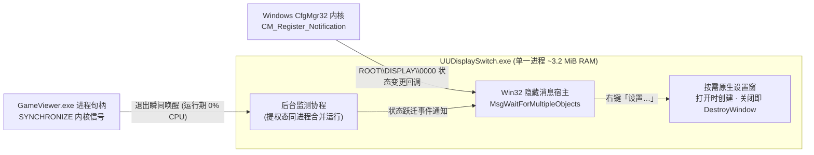

<div align="center">

# UUDisplaySwitch

**专为网易 UU 远程玩家打造的超轻量虚拟显示器一键切换与自动化工具**

纯 Go + Win32 原生 API 构建 · `3.5 MB` 独立单文件 · `~3.2 MB` 常驻内存 · `0.00%` 空闲 CPU

[](https://github.com/0neblaze/UUDisplaySwitch/releases/latest)
[](https://github.com/0neblaze/UUDisplaySwitch/releases/latest)
[-00ADD8?style=flat-square&logo=go)](go.mod)
[](#极致轻量化实测对比)
[](LICENSE)

[立即下载](https://github.com/0neblaze/UUDisplaySwitch/releases/latest) · [为什么做它](#为什么做它) · [极简交互](#极简交互设计) · [架构与性能](#极致轻量化实测对比) · [命令行支持](#命令行接口cli) · [源码构建](#从源码构建)

</div>

---

## 为什么做它

使用 **网易 UU 远程（GameViewer）** 开启「被控端防窥黑屏」功能时，系统会注册一块虚拟显示适配器 `GameViewer Virtual Display Adapter`（`ROOT\DISPLAY\0000`）。

但当你回到电脑前准备本地游玩 **《无畏契约》（VALORANT）** 等对多显示器拓扑敏感的全屏独占游戏时，只要这块虚拟屏仍处于启用状态，游戏往往会出现**无法选择原生全屏分辨率、画面比例异常或全屏模式失效**的问题。每次手动打开「设备管理器 → 显示适配器 → 右键禁用/启用」既割裂又繁琐。

**UUDisplaySwitch** 将整个切换与善后流程浓缩进了一个 **`3.54 MiB` 的无依赖单文件 `.exe`**：
- 在电脑前打游戏？**左键点一下托盘图标**，直接秒关虚拟屏。
- 远程用完退出 UU？**自动检测主进程退出**，6 秒防抖确认后自动帮你关掉虚拟屏（甚至顺带自动退出本工具）。
- 平时挂在后台？**内核事件阻塞等待**，不轮询、不刷盘，`0.00%` CPU 占用。

---

## 核心特性

- **真正零依赖单文件**：图标资源、`PerMonitorV2` 高分屏清单与 `ComCtl32 v6` 视觉样式通过自研纯 Go COFF 资源打包器直接编译进单个 `.exe`，无需 .NET、无需 Windows App SDK、无需外部 `app.ico`，下载即用。
- **直觉级托盘交互**：双击静默入驻系统托盘，动态抗锯齿彩色状态角标（绿 = 已开启 / 灰 = 已关闭 / 黄 = 切换中）一眼辨识当前状态。
- **智能防远端黑屏保护**：本地未运行 `GameViewer.exe` 时左键点击**零弹窗直接秒切**；仅当检测到 UU 远程会话正在运行时关闭虚拟屏，才会弹出原生确认框防止误触断联。
- **UU 退出自动化联动**：支持「退出 UU 后自动禁用虚拟屏」与「退出 UU 后自动退出本工具」独立或组合开启；内置 **6 秒防抖** 与 **`upgrade.exe` 更新豁免**，UU 缩到托盘或在线升级绝不误触发。
- **按需创建、即关即毁的原生设置窗**：启动时不创建任何主界面窗口；右键打开设置仅创建 `8` 个原生交互控件（文本与圆角卡片通过单次 `WM_PAINT` 直接绘制），关闭窗口立即 `DestroyWindow` 完整归还 GDI/USER 句柄。
- **原生深浅色与多语言**：自动跟随 Windows 11 深色/浅色主题与高对比度无障碍模式（`DWM` 沉浸式标题栏 + 自绘深色托盘菜单），内置简体中文、繁體中文、English 实时切换。
- **硬件级身份锁死**：操作前严格执行三重校验（设备实例 ID + 适配器名称 + 显示设备类 GUID），**物理级杜绝误触 NVIDIA / AMD / Intel 实体显卡**。

---

## 极简交互设计

| 操作动作 | 触发行为 |
| :--- | :--- |
| **双击 `UUDisplaySwitch.exe`** | 不弹主窗口，直接在右下角任务栏系统托盘显示状态图标（若已在运行则通过气泡提示位置或唤起已打开的设置窗） |
| **左键单击托盘图标** | **直接切换「开启 / 关闭」**：本地状态立即秒切；若检测到 `GameViewer.exe` 正在远控且执行关闭，弹出防黑屏确认 |
| **右键单击托盘图标** | 弹出深浅色自适应菜单：顶部展示设备与监测实时摘要，下方提供 **「设置…」** 与 **「退出」** |

> [!TIP]
> Windows 11 默认会将新程序的托盘图标收纳在任务栏右下角 `^` 折叠面板内。首次运行后，可在 **系统设置 → 个性化 → 任务栏 → 其他系统托盘图标** 中打开 `UUDisplaySwitch` 开关（或直接将图标拖出到任务栏外侧），即可随时一键左键切换。

---

## 极致轻量化实测对比

从早期基于 WinUI 3 / .NET 10 的实现重构至纯 Go + Win32 事件驱动架构（v2.4.0）后的同机实测数据：

| 评估维度 | 旧版架构（WinUI 3 自包含） | **v2.4.0（纯 Go + Win32 原生）** | 优化幅度 |
| :--- | :---: | :---: | :---: |
| **发布产物形态与体积** | `512` 个文件 / `218.00 MiB` | **`1` 个单文件 `.exe` / `3.54 MiB`** | **体积缩减 `98.38%`** |
| **后台常驻私有工作集（Private WS）** | `45.4 – 54.7 MiB`（隐藏窗口不释放） | **`3.16 – 3.45 MiB`**（含同进程后台监测） | **内存降低 `>93%`** |
| **空闲 CPU 占用** | `~1.50%` 单核（2s 定时快照轮询） | **`0.00%`**（连续采样 CPU 增量 `0.0 ms`） | **消除常驻轮询唤醒** |
| **设置窗关闭后 UI 滞留** | `1,216+` 句柄与 XAML/D3D 管线常驻 | **连续 10 轮开关：Handles / GDI / USER 增量 `+0`** | **100% 即时释放** |
| **托盘冷启动就绪耗时** | `400 – 900 ms` | **`~53 ms`** | **提速 `8x – 15x`** |

### 事件驱动零轮询架构



---

## 安全与权限设计

1. **严格的设备白名单契约**：任何启用/禁用指令在调用 `CM_Enable_DevNode` / `CM_Disable_DevNode` 前，必须同时满足：
   - `InstanceID == "ROOT\\DISPLAY\\0000"`
   - `FriendlyName / DeviceDesc == "GameViewer Virtual Display Adapter"`
   - `ClassGUID == "{4d36e968-e325-11ce-bfc1-08002be10318}"`
   任一字段不符立即中止并拒绝操作；若目标环境驱动实例路径不同，请勿强行绕过校验。
2. **安全的开机自启隔离**：当用户在设置中开启「开机登录时自动启动后台监测」时，程序**不会**让高权限计划任务直接执行用户可写目录（如 `%LOCALAPPDATA%`）下的二进制，而是将自身复制到 `%ProgramFiles%\UUDisplaySwitch\<UserSID>\UUDisplaySwitch.exe`，校验 `SHA-256` 一致性，并施加 `O:BAD:P` 保护型访问控制列表（仅 `SYSTEM` 与 `Administrators` 可写，当前用户只读可执行），从根源阻断本地路径替换提权风险。
3. **沙盒重定向检测**：启动写入前通过 `GetFinalPathNameByHandle` 校验 `%LOCALAPPDATA%\UUDisplaySwitch` 真实落盘路径，防止 MSIX / 容器虚拟化导致普通进程与高权限进程读写分裂。

---

## 快速开始

1. 前往 [**Releases**](https://github.com/0neblaze/UUDisplaySwitch/releases/latest) 下载最新的单个文件 **`UUDisplaySwitch.exe`**。
2. 将 `UUDisplaySwitch.exe` 放到任意固定目录（如 `D:\Tools\` 或 `%LOCALAPPDATA%\Programs\UUDisplaySwitch\`），双击即可启动驻留托盘。
3. 左键点击托盘图标切换虚拟显示器开关；右键点击托盘图标配置 UU 退出自动化、开机监测、主题或界面语言。

### 命令行接口（CLI）

除双击图形托盘运行外，`UUDisplaySwitch.exe` 也支持脚本化调用（可用于 AutoHotkey、Stream Deck 或批处理联动）：

| 参数 | 说明 |
| :--- | :--- |
| *(无参数)* / `--tray` | 启动系统托盘常驻模式（单实例保护） |
| `--settings` | 启动托盘（若未运行）并直接打开/聚焦「设置」窗口 |
| `--status` | 以 JSON 输出当前虚拟显示器、UU 进程与后台监测状态（只读） |
| `--apply enable` / `--apply disable` | 直接启用或禁用经身份核验的 `ROOT\DISPLAY\0000` 适配器（需管理员权限） |
| `--watch` / `--stop-watch` | 启动或请求停止后台 UU 退出监测器 |
| `--tray-status` / `--stop-tray` | 查询托盘就绪状态（JSON）或请求安全退出当前常驻托盘 |
| `--read-only --validate-ui` | 在隔离命名空间内运行三语、深浅色与多轮开关句柄泄漏自检（零副作用） |

---

## 从源码构建

本项目构建**仅依赖 Go 工具链**（`CGO_ENABLED=0`，无需 C/C++ 编译器、无需 Visual Studio、无需 .NET SDK）：

- **环境要求**：Windows 10/11 x64、PowerShell、Go `1.26` 或更高版本

```powershell
# 克隆仓库
git clone https://github.com/0neblaze/UUDisplaySwitch.git
cd UUDisplaySwitch

# 执行单元测试、go vet 静态检查、生成 COFF PE 资源并编译单文件产物
pwsh -NoProfile -File .\build.ps1
```

构建完成后，独立可执行文件输出于 `dist\UUDisplaySwitch.exe`。

---

## 数据存储与隐私

运行期配置与诊断记录仅保存在本地当前用户目录 `%LOCALAPPDATA%\UUDisplaySwitch\` 下，**全程无任何联网请求或遥测上报**：
- `settings.json`：主题、语言及自动化开关偏好
- `monitor.json`：后台监测器身份令牌与状态快照（仅在状态跃迁时原子更新）
- `actions.jsonl`：设备启停与异常诊断日志（超过 `256 KB` 自动轮转）

---

## 许可证与声明

- 本项目源码基于 [MIT License](LICENSE) 开源，第三方依赖声明见 [THIRD_PARTY_NOTICES.md](THIRD_PARTY_NOTICES.md)（直接依赖仅 `golang.org/x/sys`）。
- 本项目为个人独立开发的效率工具，与网易（NetEase）、UU 远程（GameViewer）及拳头游戏（Riot Games）官方无关。
